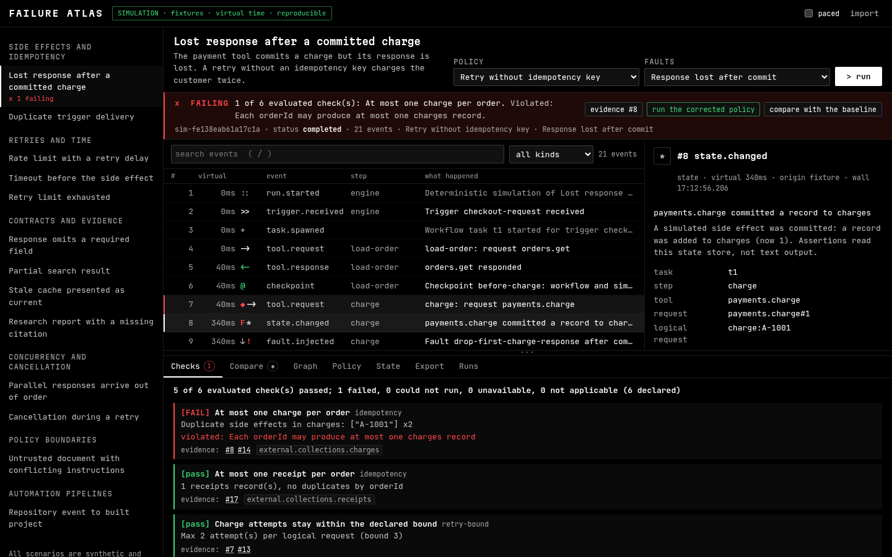

# Failure Atlas

A local-first lab for agent and workflow failures. Run a workflow against fixture tools in virtual time, inject a fault at an exact request, watch the run break, compare it with a corrected run, fork from a checkpoint, and export the failure as a regression bundle that the CLI re-executes and verifies.

Everything runs on your machine. Shipped scenarios are synthetic and use local fixtures only. Nothing calls an external service unless you explicitly start live mode with your own endpoint.



## Quick start

Requires Node 20 or newer.

```bash
npm install
npm run dev            # web UI at http://localhost:5173, opens on a failing example
npm test               # 94 unit and integration tests
npm run build          # web app in dist/web, single-file CLI in dist/cli/fa.mjs
```

The UI opens directly into the duplicate-charge scenario: the payment tool commits a charge, the response is lost, and a retry without an idempotency key charges the customer twice. The failed check links to the two `state.changed` events that prove it, and the Compare tab shows the first divergence from the corrected run.

## Three execution modes

| Mode | What it is | Reproducible | Can fork or bundle |
| --- | --- | --- | --- |
| **Simulation** | A registered workflow runs against declared fixtures in virtual time with a seeded scheduler. | Yes: identical inputs give identical normalized events and state hashes. | Yes |
| **Playback** | An imported trace (native JSON or OTLP/JSON GenAI spans). Events are shown as recorded. | No | No |
| **Live** | A real model behind an OpenAI-compatible endpoint drives a scenario's fixture tools. The run is recorded. | No | No |

The mode is always shown in the header. Playback and live traces never claim deterministic replay.

## CLI

```bash
npm run fa -- list
npm run fa -- run lost-response-duplicate-charge --policy faulty --faults lost-response
npm run fa -- compare lost-response-duplicate-charge --a corrected:lost-response --b faulty:lost-response
npm run fa -- fork lost-response-duplicate-charge --policy faulty --faults lost-response --at before-charge --to-policy corrected
npm run fa -- graph lost-response-duplicate-charge --policy faulty --faults lost-response
npm run fa -- export lost-response-duplicate-charge --policy faulty --faults lost-response --out dup.bundle.json
npm run fa -- verify dup.bundle.json       # exit code 0 only if every expectation reproduces
npm run fa -- inspect examples/otel-genai-sample.json
npm run fa -- matrix                       # every scenario x policy x fault preset
```

After `npm run build`, the same commands run as `node dist/cli/fa.mjs <command>`. That file has no runtime dependencies.

## Scenarios

Thirteen synthetic scenarios, each with a faulty and a corrected policy, fault presets, and state-based assertions:

| Mechanism | Scenario |
| --- | --- |
| Side effects and idempotency | Lost response after a committed charge (forkable at `before-charge`); duplicate trigger delivery |
| Retries and time | Rate limit with a retry delay; timeout before the side effect; retry limit exhausted |
| Contracts and evidence | Response omits a required field; partial search result; stale cache presented as current; research report with a missing citation |
| Concurrency and cancellation | Parallel responses arrive out of order; cancellation during a retry |
| Policy boundaries | Untrusted document with conflicting instructions |
| Automation pipelines | Repository event to built project |

Assertions read the simulated state store and recorded events, not text output. Outcomes are `pass`, `fail`, `error`, `unavailable` or `not-applicable`, and only `pass` counts as passing. Expected outcomes for every scenario/policy/preset combination are specified independently in `tests/expected-outcomes.ts` and checked by the tests.

## How it works

```
src/engine/        deterministic runner, fixtures, faults, assertions, comparison, graph, bundles, redaction, validation
src/scenarios/     workflow definitions (TypeScript generators) and declarative scenario data
src/integrations/  OTLP/JSON GenAI span import (semantic conventions pinned to a commit)
src/live/          OpenAI-compatible live adapter and a credential-free local stub server
src/cli/           the failure-atlas CLI
src/web/           React UI; the engine runs in a Web Worker
bench/             generated 10k-event benchmark
scripts/           screenshots, UI interaction checks, browser benchmark, clean-environment bundle check
```

- **Virtual time.** Workflows yield operations (`call`, `sleep`, `set`, `checkpoint`, `parallel`, …) to the runner. Timeouts, backoff, `Retry-After`, and latency advance a virtual clock; ties are broken by a seeded scheduler.
- **Fixtures.** Requests match by tool, canonical arguments (exact or declared fields), relevant state, occurrence and logical request id. Ambiguous or missing matches are recorded as execution errors, never guessed.
- **Faults** target a tool, request id, logical id or occurrence at a named point (`before-request`, `after-tool-commit`, `before-response`, `trigger-delivery`, `clock`) with effects such as error, timeout, dropped response, delay, removed or changed fields, truncation, duplication and cancellation.
- **Forks** replay the parent configuration to a declared checkpoint, verify that the replayed prefix hashes to the parent's recorded prefix, then continue with a different policy or fault plan. The parent run is immutable.
- **Comparison** aligns two runs by semantic step and request lineage (Myers diff) and reports the first observed divergence with the downstream events it reaches. It does not claim root cause.
- **Regression bundles** contain the scenario, contracts, fixtures, policy, fault plan, seed, engine and schema versions, expected hashes and assertion outcomes, an optional redacted copy of the source trace, and an integrity hash.

## Integrations and their scope

**OTLP/JSON GenAI import (playback only).** Reads `resourceSpans` with `gen_ai.*` attributes for `invoke_agent`, `invoke_workflow`, `chat`, `generate_content`, `text_completion` and `execute_tool`. The semantic conventions are pinned to commit `51a0f580f8a6ad804ca4de5e033683c6fbbe5906` of `open-telemetry/semantic-conventions-genai`, stability *development*. Non-GenAI spans are skipped and counted; unsupported operations are kept as notes. The import report lists everything that was not converted.

**OpenAI-compatible live adapter.** Set `FA_LIVE_BASE_URL`, `FA_LIVE_MODEL` and optionally `FA_LIVE_API_KEY`, then run `npm run fa -- live research-report-missing-citation [--stream]`. Tools stay local fixtures. The adapter handles malformed responses, streamed and partial data, and cancellation. It is tested only against the bundled local stub (`src/live/stub-server.ts`); no provider is called in tests.

## Data handling

- Traces and scenarios stay local. Imports are validated against schemas and size limits (50 MB traces, 60 MB bundles, 250,000 events). Imported text is rendered as text, never as HTML.
- Imported scenarios are declarative data. Workflows come only from the local registry; nothing in an imported file is executed.
- Export shows a redaction preview first: secrets, authorization headers, tokens and user-selected paths are replaced in the trace copy. Automatic redaction cannot find everything; the preview says so and lists every replaced value.

## Verification

| Check | Command | Result |
| --- | --- | --- |
| Unit and integration tests | `npm test` | 94 passed |
| Types | `npm run typecheck` | clean |
| Scenario matrix (56 configurations) | `npm run fa -- matrix` | all reproducible; 19 of 28 faulty configurations fail as expected; the 2 corrected configurations with a failing check (persistent outage, upstream contract violation) are expected by the independent spec |
| Clean-environment bundle verify | `npm run check:clean-env` | both bundles reproduce with only `fa.mjs` and Node in an empty directory; a tampered bundle is rejected |
| UI interaction checks | `npm run build:web && npm run ui-check` | 45 of 45 (keyboard, reduced motion, loading, import errors, fault injection, fork, no overflow at 1440/1024/768/390) |
| Screenshots | `npm run screenshots` | `docs/screenshots/` |
| Performance (10,338-event trace) | `npm run bench`, `npm run bench:browser` | see [docs/PERFORMANCE.md](docs/PERFORMANCE.md) |

The Playwright scripts use the `playwright` package; set `CHROMIUM_PATH` to use a system Chromium.

## Limitations

- Workflows are TypeScript generators registered in this repository. Arbitrary agent code cannot be dropped in without writing a workflow definition.
- Forks are supported only at checkpoints a scenario declares, and only from an original (non-forked) simulation run. Forked runs cannot be exported as bundles yet.
- Comparison reports the first observed divergence between two recordings. It is evidence for investigation, not a proof of cause.
- OTLP import covers the listed GenAI operations of a development-stability convention; attribute names may change upstream.
- The live adapter has been exercised only against the local stub in this repository.
- Hashing uses a synchronous pure-JS SHA-256 so the browser worker and Node produce identical results; it dominates import and export time on large traces.

## License

MIT
